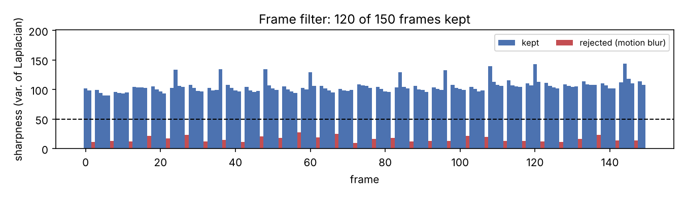
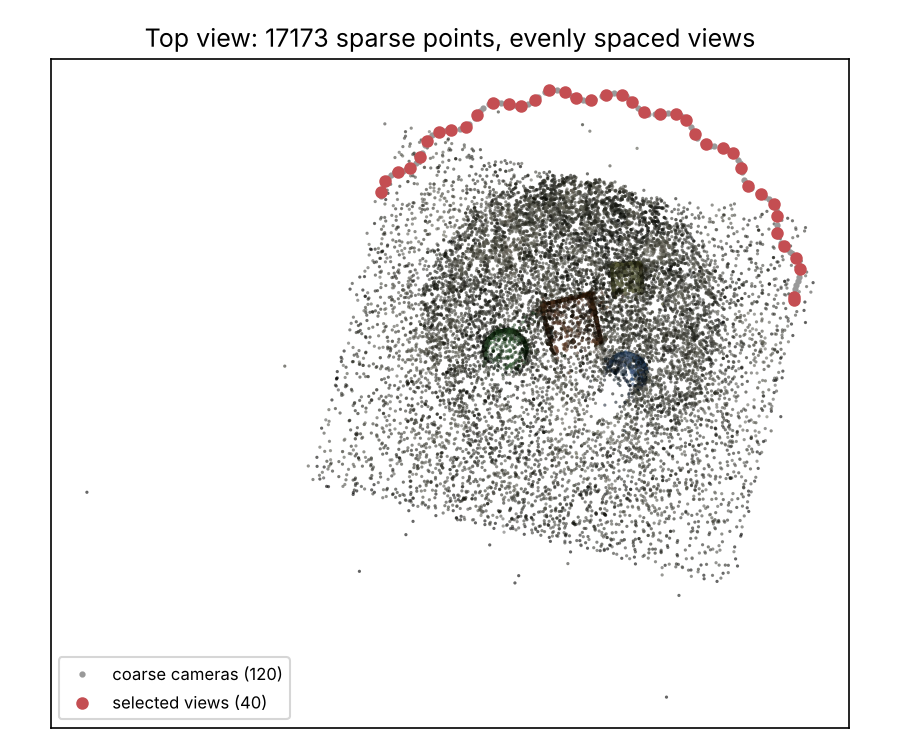
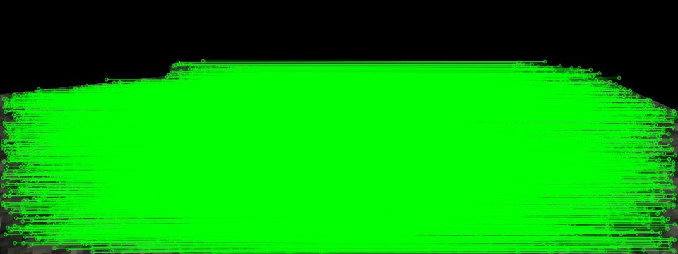

# colmap-video-toolkit

[](https://github.com/LinRungChi/colmap-video-toolkit/actions)
[](LICENSE)

**Hand-held video in, a clean COLMAP dataset for NeRF / 3D Gaussian Splatting out.**

Phone videos are the easiest way to capture a scene, but feeding every frame
to COLMAP is slow and fragile: neighbouring frames are nearly identical,
blurred frames break feature matching, and it is hard to see *why* a
reconstruction failed. This toolkit wraps COLMAP in a two-pass pipeline and
adds the diagnostics I use when preparing data for NeRF / 3DGS training.

```
video ─▶ frames ─▶ sharpness filter ─▶ coarse SfM ─▶ select N views ─▶ fine SfM ─▶ undistorted dataset
          (fps)      (drop blur)        (fast, all    evenly along     (full        images/ + sparse/0
                                         frames)      the camera path   quality)     → 3DGS, Nerfstudio
```

## Example

A 150-frame orbit video of a textured still-life (rendered in Blender, with
simulated hand-shake blur on every fifth frame):




*Coarse pass registers all 120 sharp frames; 40 views evenly spaced along the
path go to the fine pass, which registers 40/40.*


*`cvt matches` draws the verified matches of the strongest and weakest pairs
and reports isolated frames.*

| Step | Result |
|---|---|
| Frames | 150 → 120 after the sharpness filter (all 30 blurred frames rejected) |
| Coarse SfM (sequential matching) | 120 / 120 registered, 17 k sparse points |
| View selection | 40 frames evenly spaced along the path |
| Fine SfM (exhaustive matching) | 40 / 40 registered |
| Output | `work/dataset/{images, sparse/0}`, plus `report.json` |

## Install

COLMAP must be installed (`apt install colmap`, `brew install colmap`, or the
Windows release, where the executable is `COLMAP.bat`).

```bash
pip install -e ".[dev]"
pytest -q
```

## Usage

```bash
# full pipeline
cvt reconstruct scan.mp4 work --fps 5 --views 100 --min-sharpness 50
cvt reconstruct scan.mp4 work --colmap "C:/tools/colmap/COLMAP.bat"   # Windows
cvt reconstruct scan.mp4 work --dense                                 # + PatchMatch stereo (CUDA build)

# pick thresholds first: brightness / sharpness of every frame -> CSV
cvt frames scan.mp4 frames --fps 5
cvt quality frames --csv quality.csv
cvt quality masked_frames --ignore-black     # statistics on the unmasked region only

# extract a whole folder of videos, one sub-folder each
cvt frames videos/ frames/ --step 2 --min-sharpness 40

# why did it fail? per-frame match strength, isolated frames, best/weakest pair
cvt matches work/coarse/database.db --images work/frames --out match_report

# images back to a video (e.g. renders)
cvt video renders/ renders.mp4 --fps 30
```

Train 3D Gaussian Splatting on the result:

```bash
python train.py -s work/dataset          # graphdeco-inria/gaussian-splatting
ns-train splatfacto colmap --data work/dataset   # Nerfstudio
```

## How it works

| Module | Purpose |
|---|---|
| `frames.py` | OpenCV frame extraction with fps resampling and a brightness / sharpness (variance of Laplacian) filter; quality report; images → video |
| `colmap.py` | Small COLMAP CLI wrapper. Fast mode (fewer features) for the first pass; a 4° initial-pair angle for video, since COLMAP's 16° default often rejects every pair in a short matching window |
| `model_io.py` | Reads camera centres from `images.bin` and verified matches from `database.db` with only NumPy and sqlite3 |
| `select.py` | Orders cameras along the first principal axis of their positions and samples evenly |
| `match_quality.py` | Per-frame inlier totals, neighbour counts, isolated frames, match drawings |
| `pipeline.py` | The two-pass pipeline and `report.json` |

View selection assumes a mostly one-directional sweep or arc. For a full
360° loop the first principal axis folds the path; use more views or the
`--matcher exhaustive` coarse pass.

## Background

I built these scripts while preparing phone and camera captures for NeRF and
3D Gaussian Splatting in my Ph.D. work; this repository is a cleaned-up,
tested version without any project data. See my
[portfolio](https://github.com/LinRungChi/portfolio) for related work.

## License

MIT © Rung-Chi Lin
